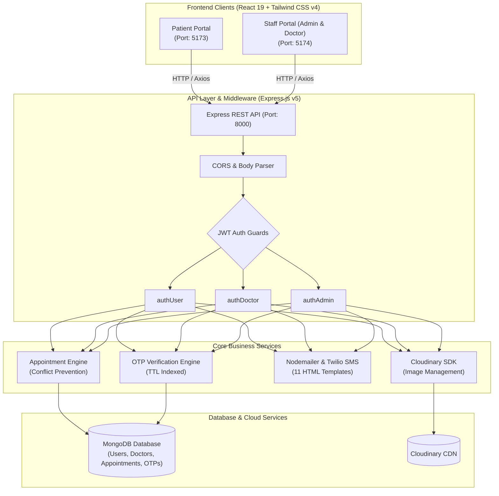
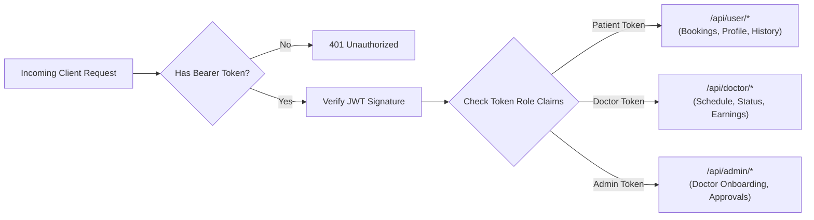
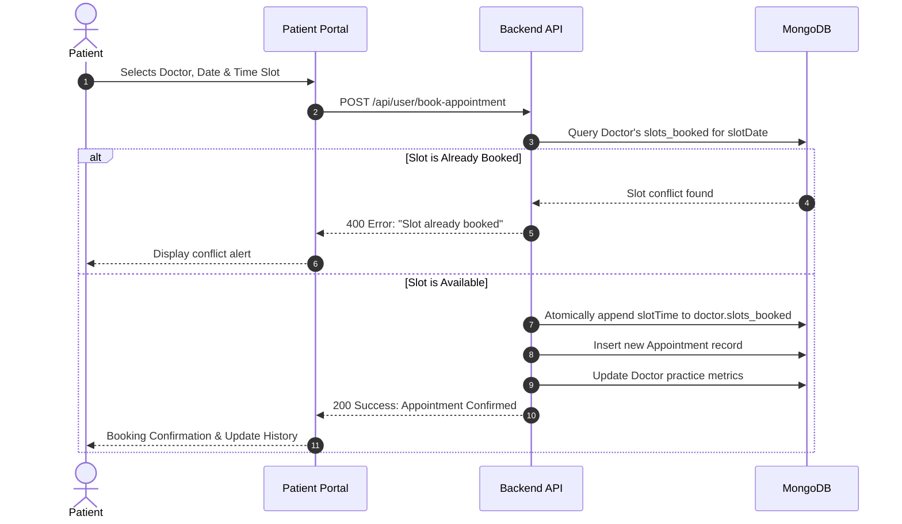
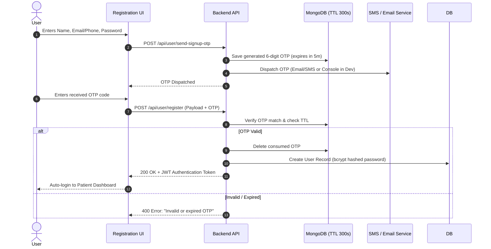

# 🏥 MEDPRO: Healthcare & Doctor Appointment Management System

[](https://react.dev/)
[](https://tailwindcss.com/)
[](https://nodejs.org/)
[](https://expressjs.com/)
[](https://www.mongodb.com/)
[](https://jwt.io/)
[](https://opensource.org/licenses/MIT)

> **MEDPRO** is a production-ready, full-stack healthcare platform engineered to streamline clinical appointments, medical operations, and doctor-patient interactions. Built on the modern **MERN Stack** (MongoDB, Express.js v5, React 19, Node.js) with Tailwind CSS v4, it provides dedicated portals with granular Role-Based Access Control (RBAC), multi-factor OTP verification, and conflict-free scheduling.

---

## 📌 Project Overview

MEDPRO bridges the operational gap between patients, healthcare providers, and clinical administration across three specialized modules:

1. **Patient Portal (`patient-portal`):** A responsive web application enabling patients to browse specialists, schedule conflict-free appointments, verify credentials via OTP, and manage consultations.
2. **Staff Portal (`staff-portal`):** A dual-role dashboard dynamically rendering isolated administrative controls for **Platform Administrators** and practice analytics for **Medical Doctors**.
3. **RESTful API Backend (`backend`):** A scalable Node.js & Express v5 server managing stateful workflows, data integrity, secure authentication pipelines, and media uploads.

---

## 🏗️ System Architecture



---

## 🔐 Role-Based Access Control (RBAC) Flow



---

## 📅 Conflict-Free Appointment Booking Lifecycle



---

## 🔑 OTP Verification & Registration Flow



---

## ✨ Key Features by Role

### 🧑‍💼 Patient Experience
- **Specialty Doctor Discovery:** Browse certified doctors dynamically classified across 6 medical specialties (General Physician, Gynecologist, Dermatologist, Pediatrician, Neurologist, Gastroenterologist).
- **Conflict-Free Booking:** Live transactional slot reservation preventing overlapping appointments.
- **Two-Step OTP Registration:** Enforces email and phone number authenticity before database creation.
- **Self-Service Profile:** Secure avatar uploads via Cloudinary and OTP-guarded phone/email modification.
- **Appointment Tracking:** Review upcoming and completed consultations, with instant payment status tracking.

### 🩺 Doctor Dashboard
- **Practice Analytics:** Private analytics tracking completed consultations, registered patients, and earnings.
- **Appointment Execution:** Real-time completion or cancellation triggers that synchronize availability system-wide.
- **Dual-Control Profile Moderation:** Instant availability toggling for emergencies, with sensitive credential/fee changes routed to the administrative approval queue.
- **OTP Password Recovery:** Multi-factor password reset pipeline.

### 🛡️ Admin Dashboard
- **Doctor Onboarding:** Direct onboarding of licensed medical practitioners with credentials, bio, and image assets.
- **Platform Availability Control:** Instant toggle of doctor visibility across the patient booking platform.
- **Profile Moderation Queue:** Strict quality control review allowing administrators to approve or decline doctor profile revisions with automated notifications.
- **System Metrics:** High-level platform overview displaying global revenue, appointments, and active doctor rosters.

---

## 🌐 Core API Endpoints

### Patient Routes (`/api/user`)
| Method | Endpoint | Description | Auth Required |
|:---|:---|:---|:---:|
| `POST` | `/send-signup-otp` | Dispatch verification OTP for registration | No |
| `POST` | `/register` | Validate OTP and initialize patient account | No |
| `POST` | `/login` | Authenticate via email or mobile number | No |
| `GET` | `/get-profile` | Fetch authenticated patient profile | `authUser` |
| `POST` | `/update-profile` | Update demographics and avatar image | `authUser` |
| `POST` | `/book-appointment` | Reserve conflict-free consultation slot | `authUser` |
| `GET` | `/appointments` | Retrieve patient booking history | `authUser` |
| `POST` | `/cancel-appointment` | Cancel an upcoming consultation | `authUser` |
| `POST` | `/send-reset-otp` | Request password reset OTP | No |
| `POST` | `/verify-reset-otp` | Validate reset OTP and issue reset token | No |
| `POST` | `/reset-password` | Set new password with verified token | No |

### Doctor Routes (`/api/doctor`)
| Method | Endpoint | Description | Auth Required |
|:---|:---|:---|:---:|
| `GET` | `/list` | Public listing of all active doctors | No |
| `POST` | `/login` | Doctor authentication | No |
| `GET` | `/appointments` | Fetch assigned consultations | `authDoctor` |
| `POST` | `/complete-appointment`| Mark consultation as completed | `authDoctor` |
| `POST` | `/cancel-appointment` | Cancel assigned consultation | `authDoctor` |
| `GET` | `/dashboard` | Practice analytics, patient totals & earnings | `authDoctor` |
| `GET` | `/profile` | Fetch doctor profile details | `authDoctor` |
| `POST` | `/update-profile` | Toggle availability or submit credential updates | `authDoctor` |

### Admin Routes (`/api/admin`)
| Method | Endpoint | Description | Auth Required |
|:---|:---|:---|:---:|
| `POST` | `/login` | Administrative authentication | No |
| `POST` | `/add-doctor` | Onboard medical practitioner (multipart) | `authAdmin` |
| `GET` | `/all-doctors` | View global doctor roster | `authAdmin` |
| `POST` | `/change-availability`| Toggle practitioner availability status | `authAdmin` |
| `GET` | `/appointments` | View all system consultations | `authAdmin` |
| `POST` | `/cancel-appointment` | System administrator cancellation | `authAdmin` |
| `GET` | `/dashboard` | System-wide statistics and earnings | `authAdmin` |
| `GET` | `/update-requests` | View pending doctor credential updates | `authAdmin` |
| `POST` | `/approve-update` | Approve profile modification | `authAdmin` |
| `POST` | `/reject-update` | Decline profile modification | `authAdmin` |

### System & Health Routes
| Method | Endpoint | Description |
|:---|:---|:---|
| `GET` | `/` | API service root information |
| `GET` | `/api/health` | Uptime check and service health probe |

---

## 🔧 Installation & Local Setup

### Prerequisites
- [Node.js](https://nodejs.org/) (v18.x or later)
- [MongoDB Atlas](https://www.mongodb.com/atlas) cluster or local MongoDB instance
- [Cloudinary](https://cloudinary.com/) account for avatar image storage

### 1. Clone the Repository
```bash
git clone https://github.com/tilak-bytes/MEDPRO.git
cd MEDPRO
```

### 2. Backend Setup
```bash
cd backend
npm install
```
Create a `.env` file in `backend/` (or copy from `.env.example`):
```env
PORT=8000
MONGODB_URI="mongodb+srv://<username>:<password>@cluster0.mongodb.net"
JWT_SECRET="your_secure_jwt_secret"

CLOUDINARY_NAME="your_cloudinary_name"
CLOUDINARY_API_KEY="your_api_key"
CLOUDINARY_API_SECRET="your_api_secret"
CLOUDINARY_FOLDER="MEDPRO_Uploads"

ADMIN_EMAIL="admin@medpro.health"
ADMIN_PASSWORD="your_admin_password"
ADMIN_PHONE_NUMBER="+1234567890"

# Set to false for dev mode (OTPs will print directly to the backend terminal)
EMAIL_ENABLED=false
EMAIL_USER="your_email@gmail.com"
EMAIL_PASS="your_gmail_app_password"

SMS_ENABLED=false
TWILIO_ACCOUNT_SID="your_twilio_sid"
TWILIO_AUTH_TOKEN="your_twilio_token"
TWILIO_PHONE_NUMBER="your_twilio_number"
```
Start the backend server:
```bash
npm run dev
```

### 3. Patient Portal Setup
Open a new terminal window:
```bash
cd patient-portal
npm install
```
Create `.env` inside `patient-portal/`:
```env
VITE_BACKEND_URL=http://localhost:8000
```
Start the development server:
```bash
npm run dev
```

### 4. Staff Portal Setup
Open another terminal window:
```bash
cd staff-portal
npm install
```
Create `.env` inside `staff-portal/`:
```env
VITE_BACKEND_URL=http://localhost:8000
```
Start the staff dashboard:
```bash
npm run dev
```

---

## 🚀 Deployment Guide

### Frontend Deployment (Vercel)
Both `patient-portal` and `staff-portal` include pre-configured `vercel.json` routing configurations to support React Router single-page navigation:
1. Import the repository into [Vercel](https://vercel.com).
2. Set Root Directory to `patient-portal` (for patient app) or `staff-portal` (for staff app).
3. Set Environment Variable: `VITE_BACKEND_URL` = `https://your-backend-api.onrender.com`.
4. Deploy!

### Backend Deployment (Render / Railway)
1. Create a Web Service pointing to the repository.
2. Set Root Directory to `backend`.
3. Build Command: `npm install`
4. Start Command: `npm start`
5. Populate environment variables from `backend/.env.example`.
6. Health Check Path: `/api/health`.

---

## 👤 Author

**Tilak**  
- **GitHub:** [@tilak-bytes](https://github.com/tilak-bytes)  
- **Email:** [engineer.tilak2027@gmail.com](mailto:engineer.tilak2027@gmail.com)  

---

## 📄 License

This project is licensed under the **MIT License** — feel free to use and adapt it for learning and portfolio purposes.
